# DueMate screens

A reference for every main screen, sheet and form, in light and dark. The data shown is the
sample ledger seeded by the screenshot harness (four people, two EMIs, five expenses).

The images are generated, not hand-made. After a UI change, regenerate them with:

```bash
flutter test test_screens/screens_test.dart --update-goldens --dart-define=DOCS=true
```

Design rules behind these screens are in [`CLAUDE.md`](../CLAUDE.md#design-system). The short version:
green is money coming to you, red is money you owe, everything else is neutral; each screen
leads with its one important number; destructive actions live in detail views and confirm first.

---

## Tabs

### Home

<p>
  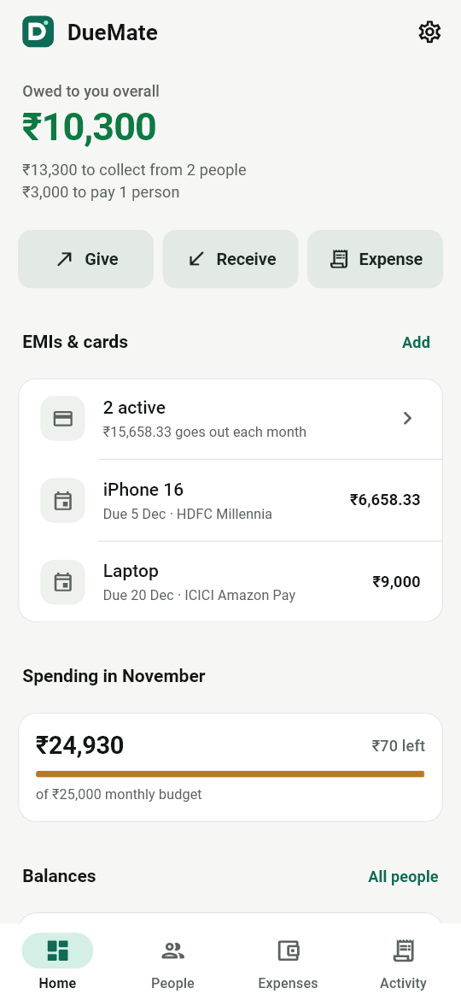
  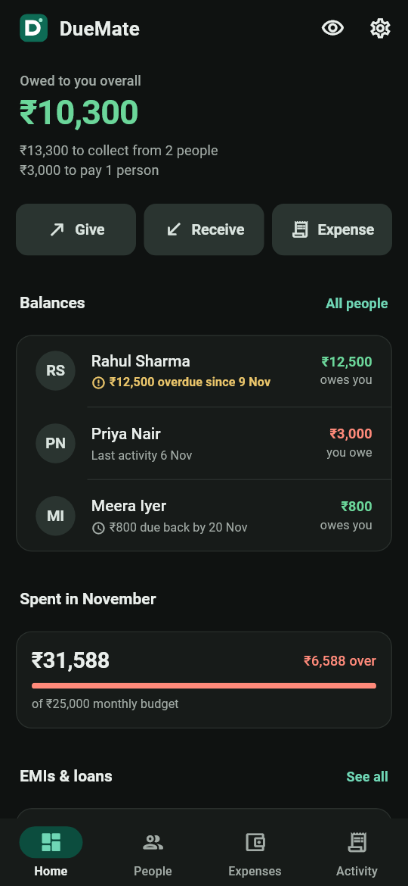
</p>

Where you stand overall (owed to you / you owe, and the two sides), then the three things you do
most: **Give**, **Receive**, **Expense**.

- **EMIs & cards**: active count and what goes out each month (tap for all EMIs), the next
  installments due (tap for the schedule), and **Add** for a new EMI or loan.
- **Spending in &lt;month&gt;**: spent so far against the monthly budget.
- **Balances**: the largest open balances; **Recent**: the last five entries.
- With no data yet, Home shows a short welcome with *Add a person* and *Add an expense*.

**Hide amounts.** The eye icon in the top bar (also a switch in Settings) masks every balance and
total across the app, for using it in public. Labels, counts and dates stay readable; amounts you
type, exports and shared messages are never masked. The choice is remembered. Showing amounts again
asks for your fingerprint, face or screen lock, so someone you hand the phone to can't un-hide them.

<p>
  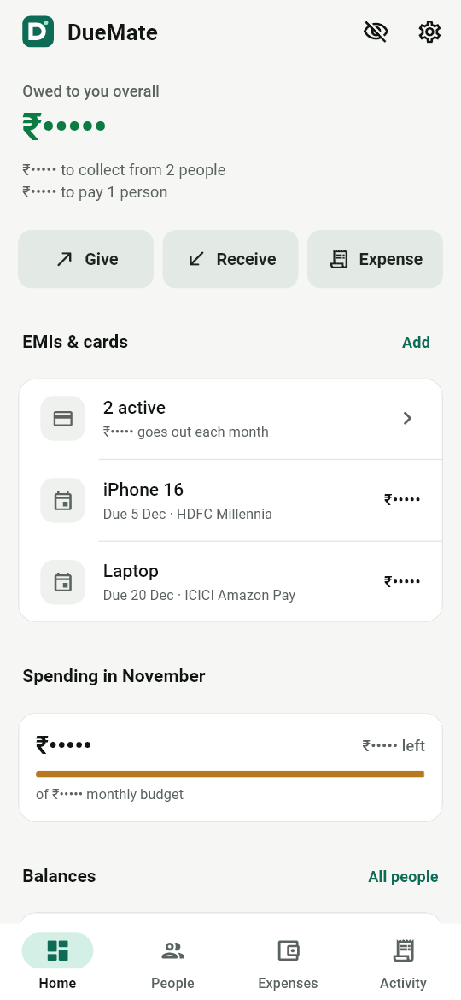
  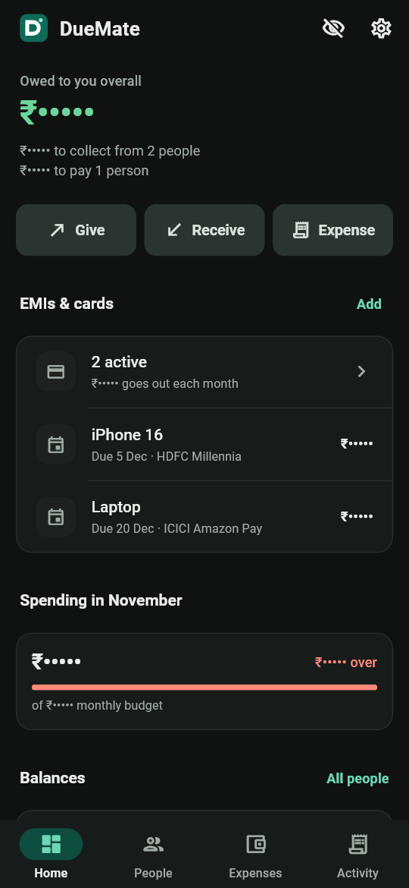
</p>

### People

<p>
  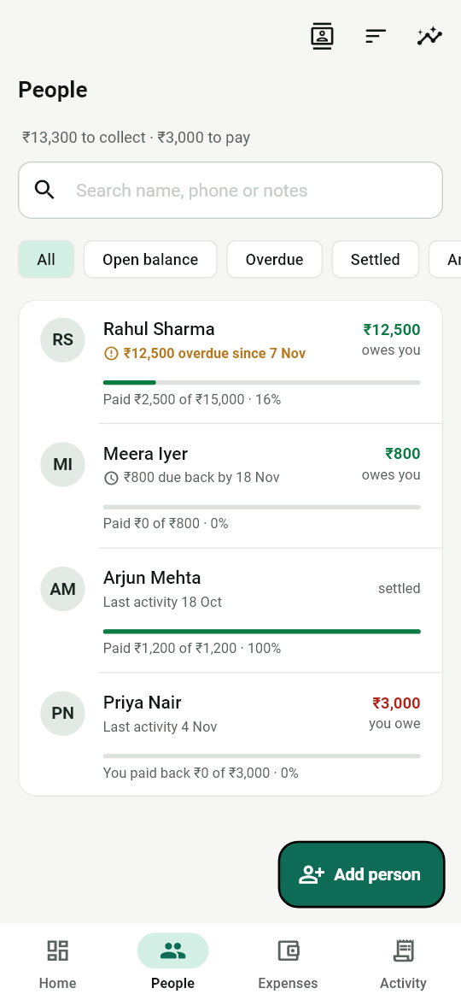
  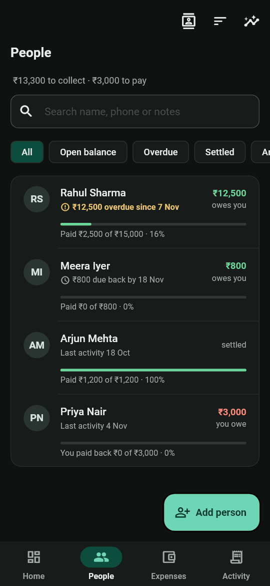
</p>

Everyone you deal with, one row each: last activity, the balance in words (*owes you*,
*you owe*, *settled*), and a **repayment bar**: how much has been paid back so far, e.g. *Paid ₹2,500
of ₹15,000 · 16%* (green when it's money coming back to you; *You paid back …* in neutral ink when
you owe them). The percentage rounds down, so 100% means fully paid. Search by name, phone or notes; filter by open balance, settled or
archived; sort from the top bar; add from contacts; the chart icon opens **Lending trends**.

**Due back.** When you give money with a *Return by* date, the row says when it's due
(*₹800 due back by 18 Nov*, *tomorrow*, *today*) in place of last activity. Once the date passes
it turns to *₹12,500 overdue since 7 Nov* in amber with a warning icon (overdue money is owed to you,
so it's never red). Repayments pay off the oldest loans first, so only the unpaid part counts. The
**Overdue** filter lists everyone who's late; Home's Balances show the same line.

- **Tap** a person to open their ledger.
- **Long-press** for shortcuts: give, receive, WhatsApp reminder.

### Expenses

<p>
  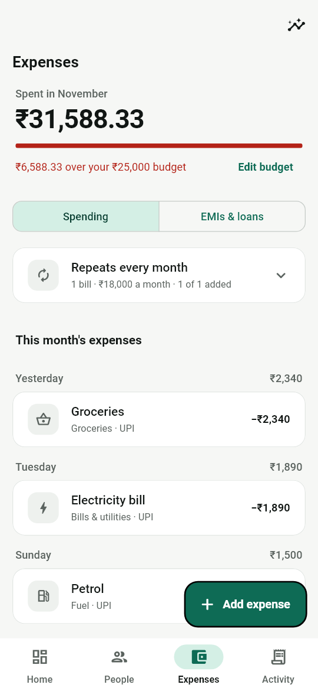
  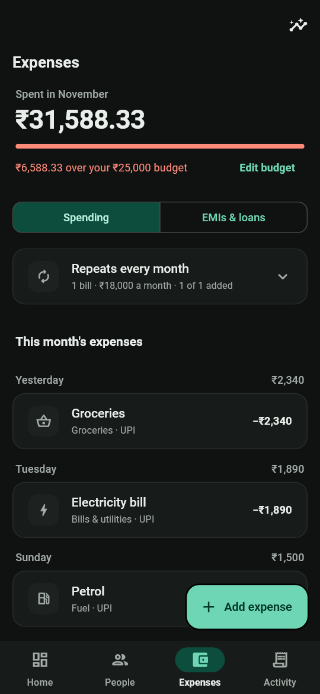
</p>

This month's spending against the budget (*left*, *only … left* from 85%, *over* in red), then
expenses grouped by day with a daily total. Tap an expense to edit or delete it.
*Earlier months* and the chart icon open **Spending trends**.

**Repeats every month** lists recurring expenses (rent, subscriptions) with the day they post and
the next date. They're added as ordinary expenses on that day each month (the 31st posts on the
last day of shorter months), catching up on any months missed while the app wasn't opened. Tap one
to **change the amount** (from now on; past months keep theirs) or **stop repeating** (asks first;
expenses it already added stay).

<p>
  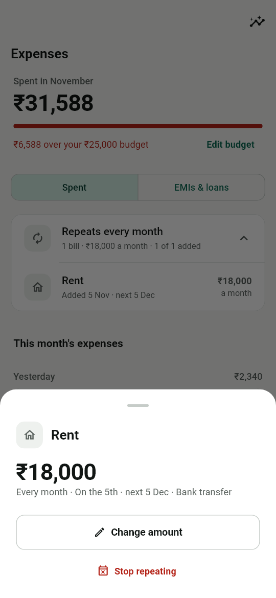
  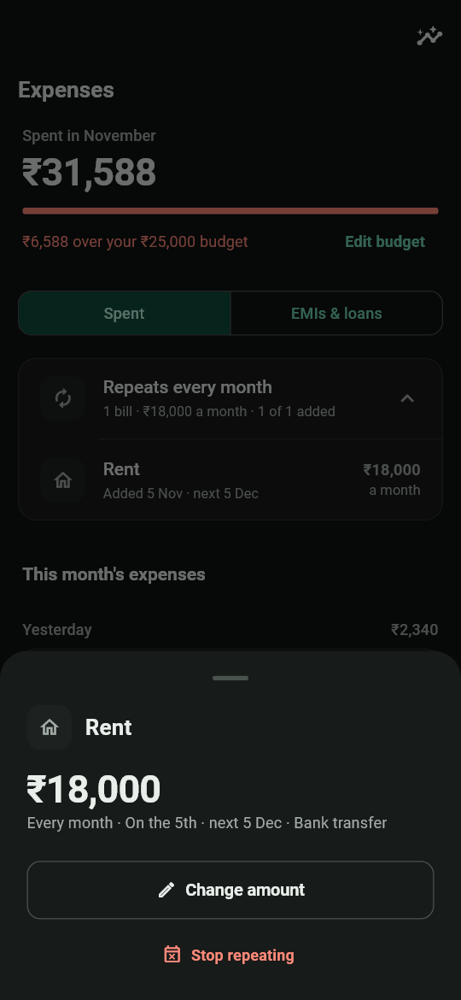
</p>

<p>
  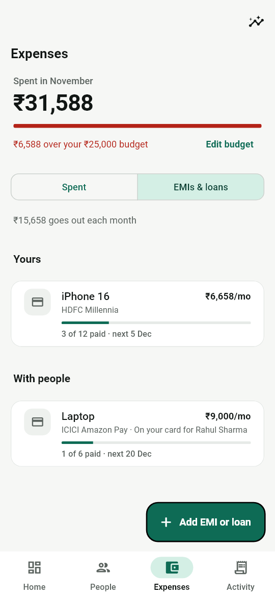
  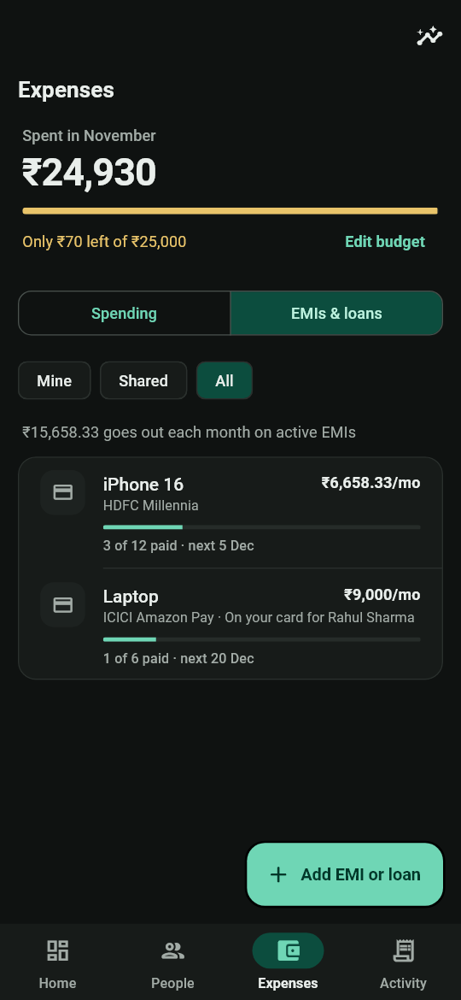
</p>

**EMIs & loans** view: filter mine / shared / all, the monthly outgo on active EMIs, and each
EMI with progress and the next due date. Tap one for its schedule.

### Activity

<p>
  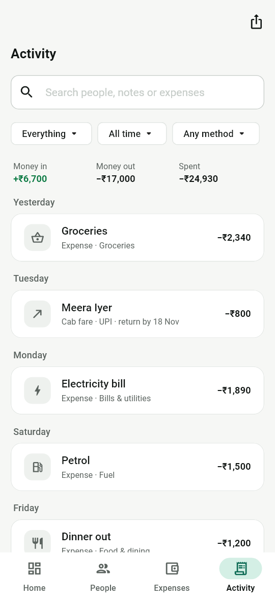
  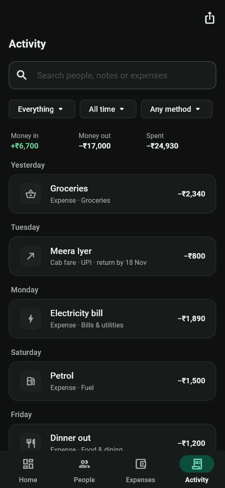
</p>

Every ledger entry and expense in one timeline, grouped by day. Search, then narrow by type
(everything / lending / expenses), period (this month, last month, this year, custom dates) and
payment method. Totals for money in, money out and spent follow the filters. The share icon
exports the filtered entries as PDF or CSV.

---

## Pages

### Person ledger

<p>
  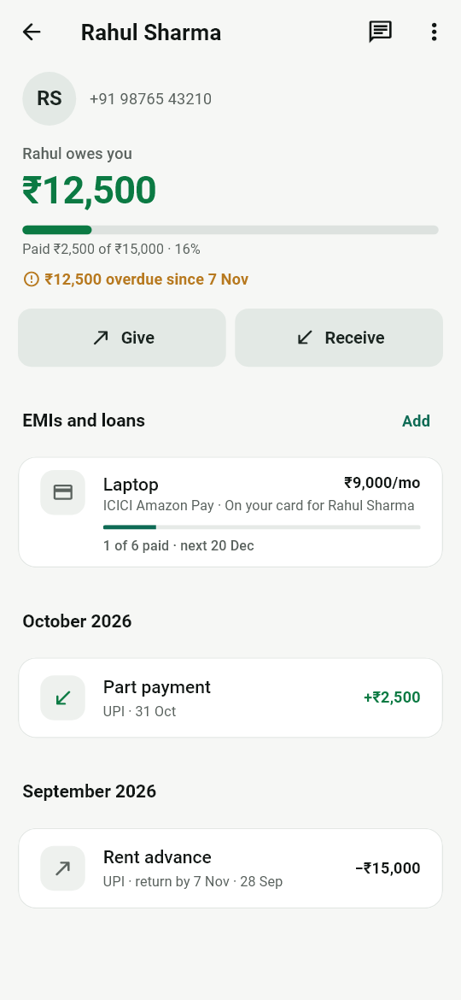
  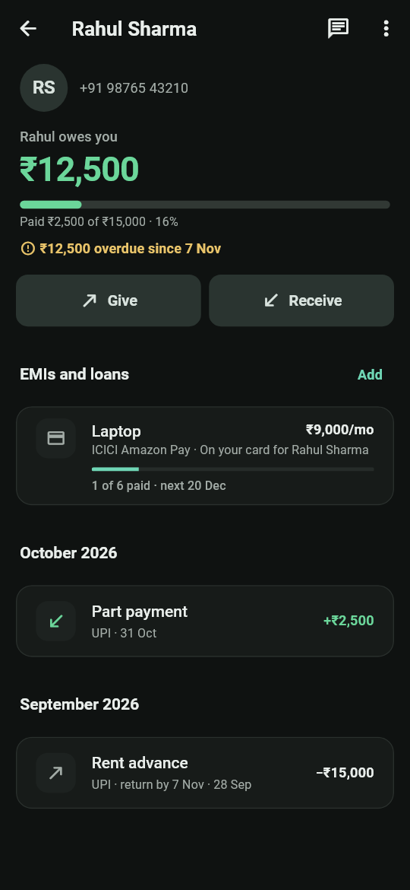
</p>

Who owes whom and how much, a larger repayment bar (*Paid ₹2,500 of ₹15,000 · 16%*), when money
is due back (or overdue), then **Give** / **Receive** for this
person. Their EMIs follow, then history by month. The top bar has a WhatsApp reminder (when they
owe you and have a number) and a menu: share statement, share balance as text, contact details,
edit, add EMI or loan, archive, delete.

### Spending trends

<p>
  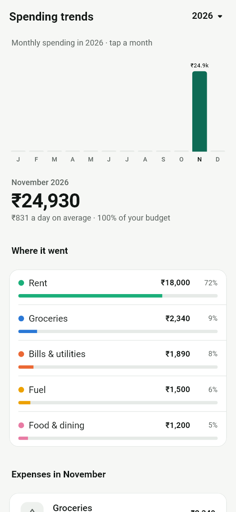
  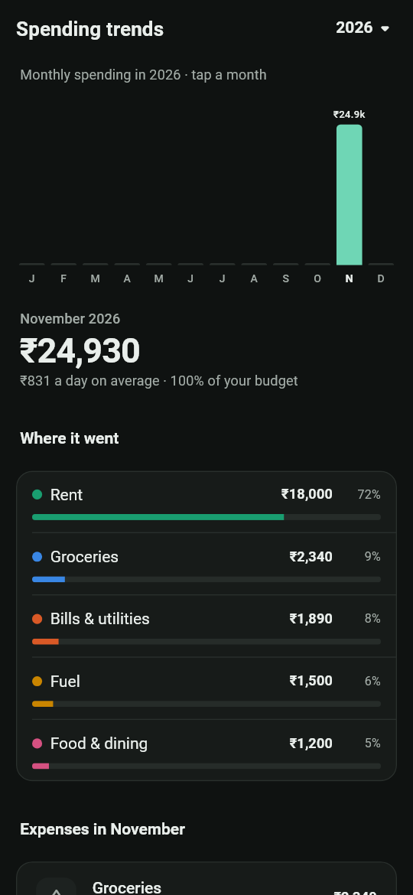
</p>

Monthly totals for a year (pick the year top right; tap a month). For the chosen month: the
total, daily average and share of budget, **where it went** by category, and every expense that
month, each editable.

### Lending trends

<p>
  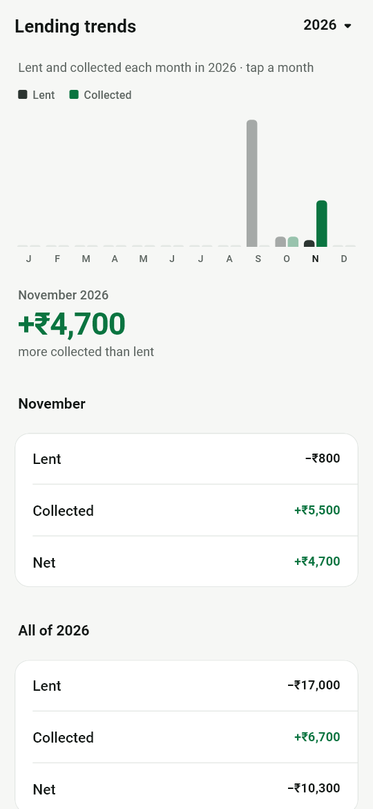
  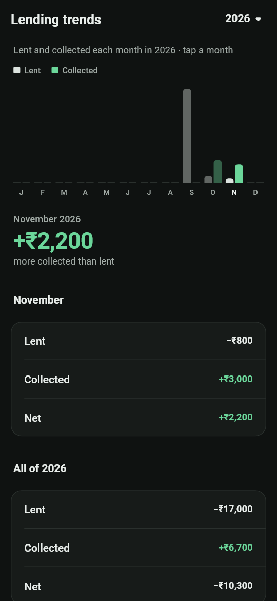
</p>

From the chart icon on **People**: money you lent and collected each month of a year, side by side
(lent in neutral ink, collected in green, with a legend). Tap a month for its numbers; it leads with
the net (+ when more came back), then lent, collected and net for the month and the whole year.
Your own EMIs are spending, not lending, so they're left out.

### Settings

<p>
  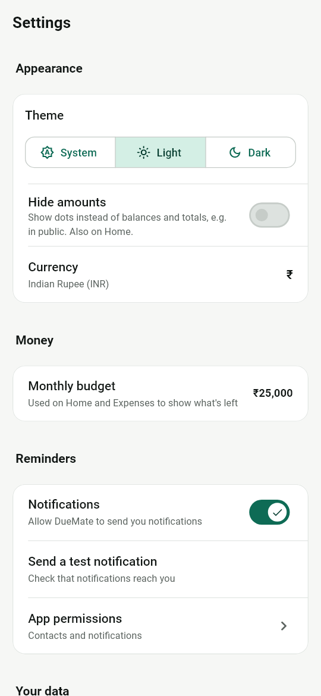
  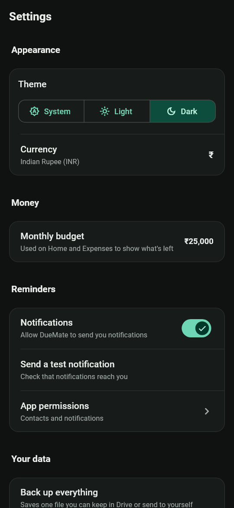
</p>

Theme, hide amounts and currency; monthly budget and your UPI ID (₹ only); App Lock and how soon it locks after you leave
the app; notifications (EMI reminders and a test notification); backup, **restore from a backup**,
CSV export, and erase all data (asks first).

**EMI reminders.** With notifications on, DueMate reminds you at 9:00 the day before each EMI
installment is due (on the day, if that's already passed), for the next three installments of every
active EMI. They stay in step automatically when EMIs are added, edited, deleted or posted, and
after a restore. While amounts are hidden or App Lock is on, reminders leave the amount out, and
their content is hidden on the lock screen.

**Restore from a backup.** Pick a backup file; DueMate shows what's in it (people, entries, EMIs,
expenses, and when it was made) and asks before replacing everything on the phone. A file that
isn't a backup, or is damaged, is refused without changing anything. About at the bottom.

### App Lock

<p>
  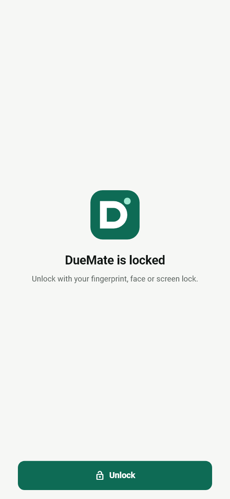
  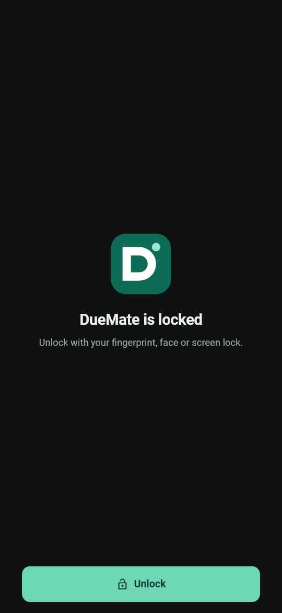
</p>

With **App Lock** on (Settings › Security), DueMate opens locked and asks for your fingerprint, face
or the phone's screen lock straight away; **Unlock** asks again if you dismissed it. It locks again
when you come back after being away for the chosen time (immediately, 30 seconds, 1 or 5 minutes).
Turning it on or off asks you to verify first. While locked, back leaves the app instead of
closing pages behind the lock, and balances are kept out of the recent-apps thumbnail. If the
phone's screen lock is removed, App Lock turns itself off rather than locking you out.

---

## Sheets and forms

### Give / Receive

<p>
  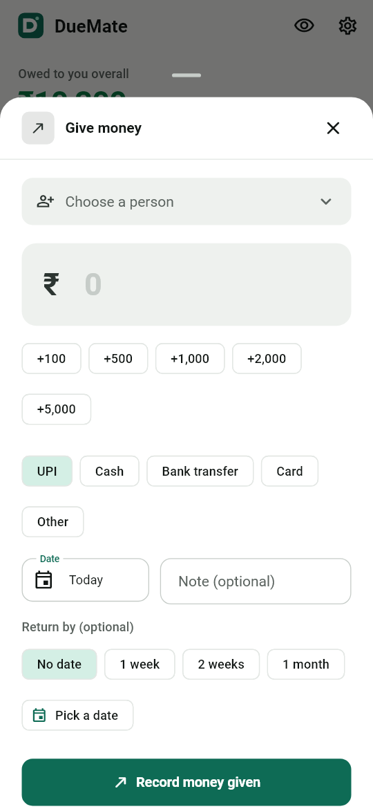
  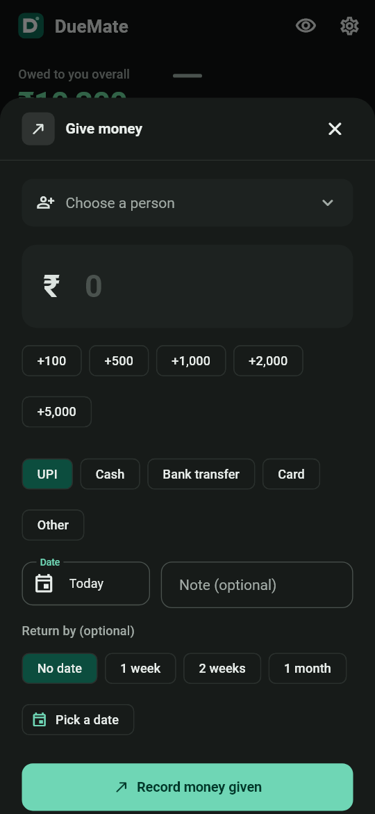
</p>

Choose a person (their balance shows, with a one-tap *settle full balance* / *pay back all* when
it applies), the amount with quick adds, payment method, date and note. Giving also has
**Return by (optional)**: no date, 1 week, 2 weeks, 1 month, or any date. You get a reminder the
day before (tap it to open that person), and the person shows as overdue once it passes. An entry's
date can be changed or cleared later from its details (*Edit*).

**UPI** (only when the currency is ₹). Giving to someone whose UPI ID is saved shows **Pay with
UPI app**: it opens your UPI app with their ID and the amount filled in. UPI apps don't tell
DueMate whether you paid, so when you come back (after unlocking, if App Lock is on) it asks **Did
the payment go through?** — **Yes, record it** saves the Give as a UPI payment; **Not yet** leaves
the sheet as it was. Receiving shows **Show UPI QR**: a QR with your UPI ID and the
amount that any UPI app can scan, which you can also **Share** as an image. The first time, it asks
for your UPI ID (also in Settings › Money). WhatsApp reminders include your UPI ID when it's set.

<p>
  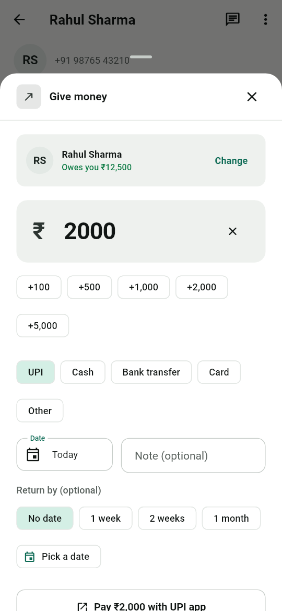
  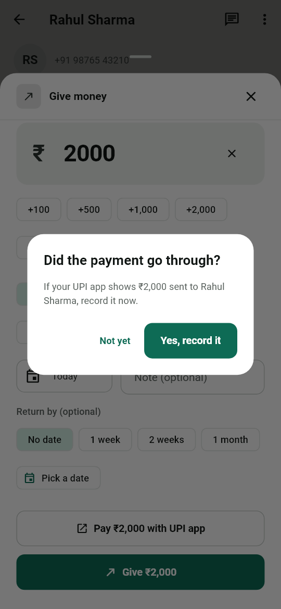
  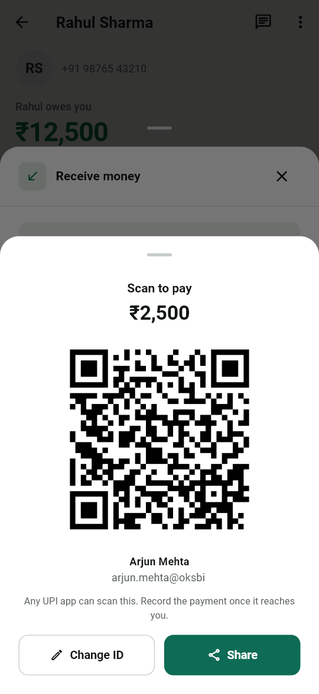
  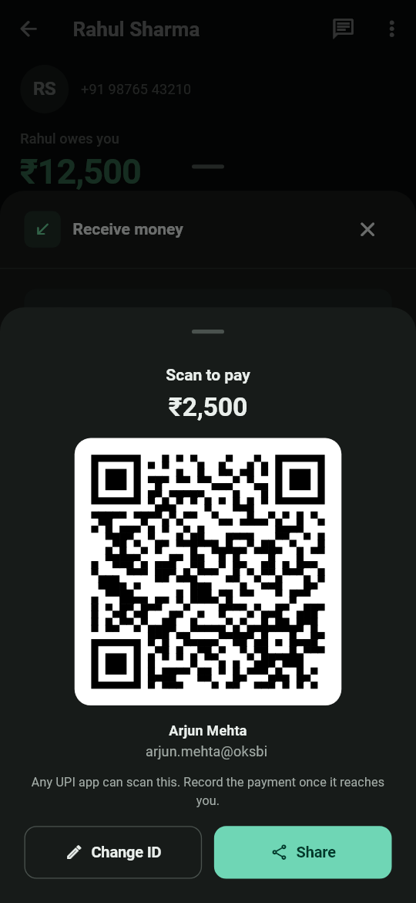
</p>

### Add expense

<p>
  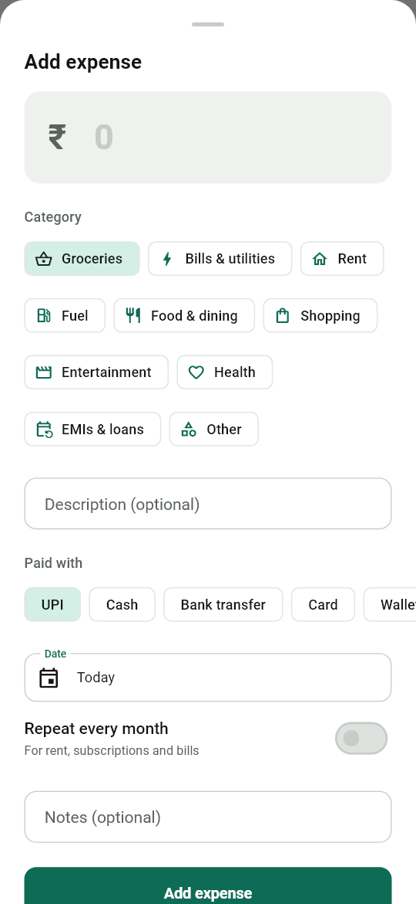
  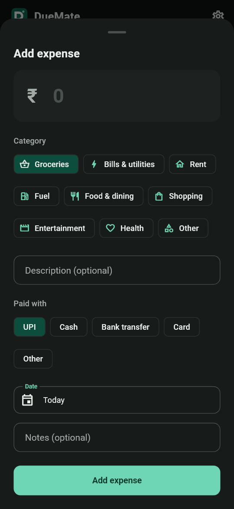
</p>

Amount first, then category. The description is optional (the category is used if empty).
**Repeat every month** (new expenses) makes it recurring from that date: this one is added now,
and the same expense is added on that day every month after.
When editing, the sheet also has *Delete expense*.

### Add EMI or loan

<p>
  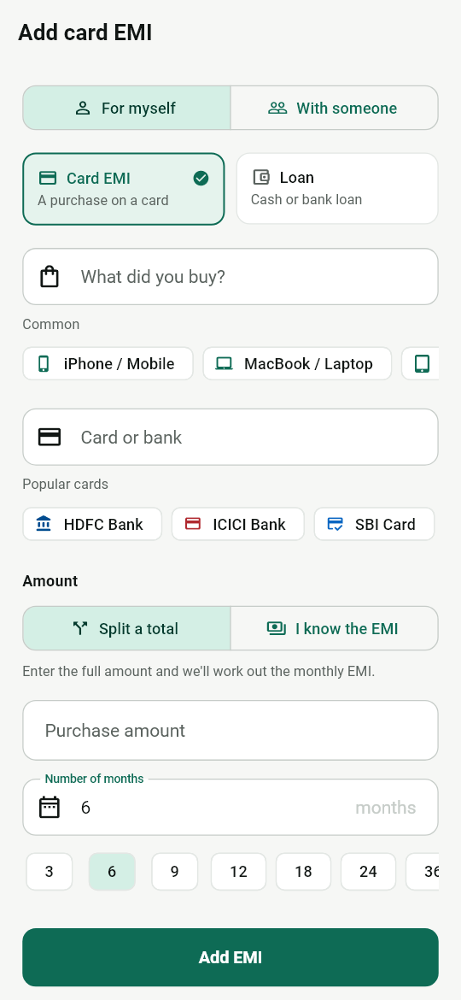
  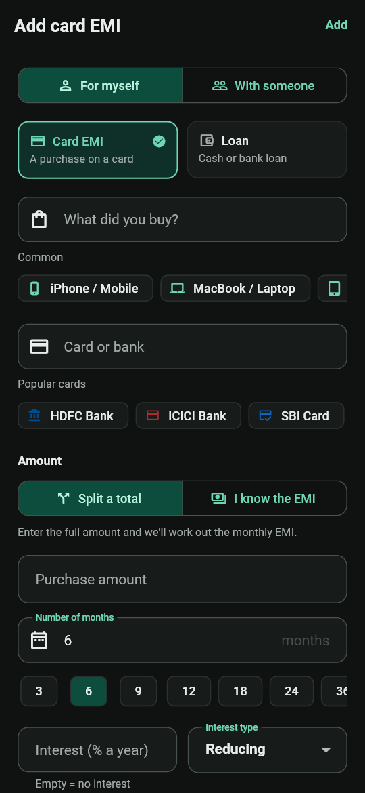
</p>

For yourself or with someone, card EMI or loan, what it was for and the card or lender. Then the
amount, entered either way:

- **Split a total**: amount, months, optional interest (reducing or flat) and charges.
- **I know the EMI**: the monthly EMI from the bank; the original amount (optional) shows the
  extra you pay and the effective yearly rate.

A live summary shows the EMI, totals and last installment; *Make some months different* sets
uneven months. Finally the first due date and installments already paid.

### EMI schedule

<p>
  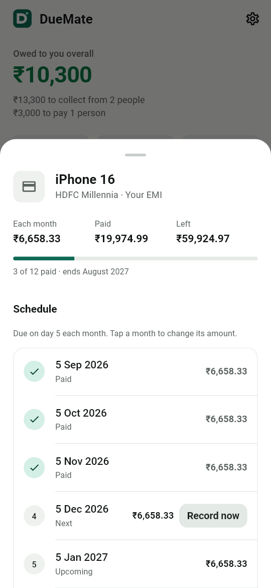
  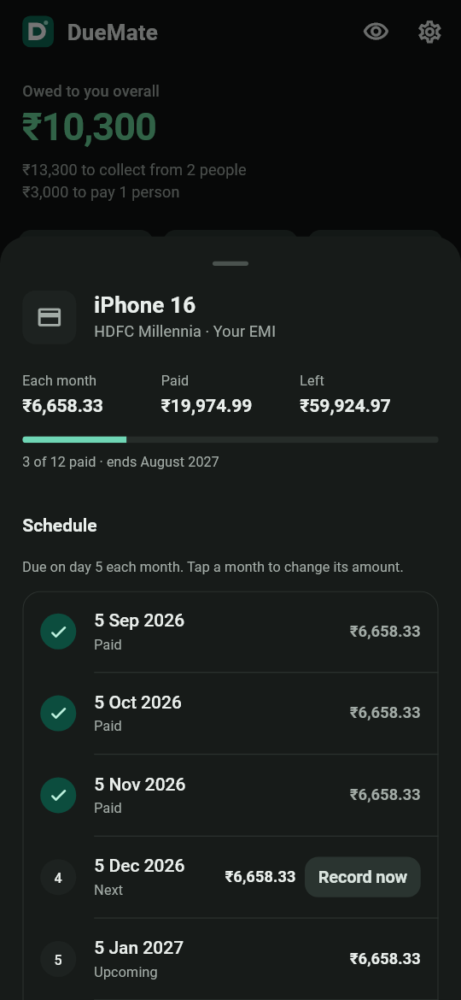
</p>

Monthly amount, paid and left, progress, then every installment. Tap a month to change its
amount; **Record now** posts the next one to the ledger early. Edit and delete at the bottom
(and a WhatsApp reminder for shared EMIs).

### Entry details

<p>
  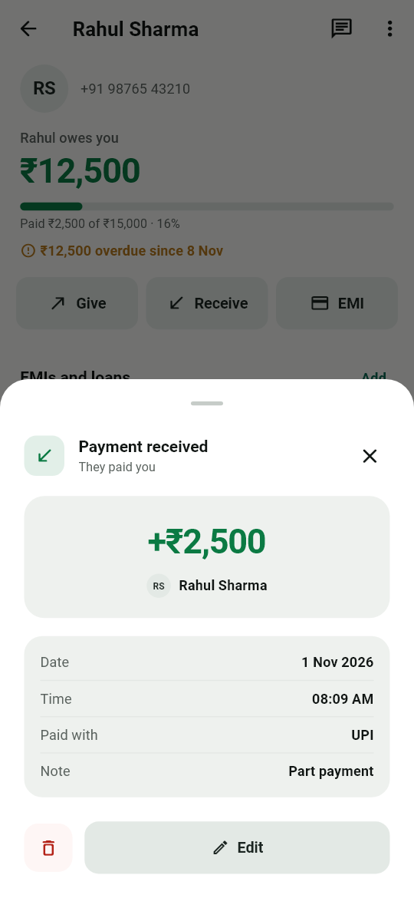
  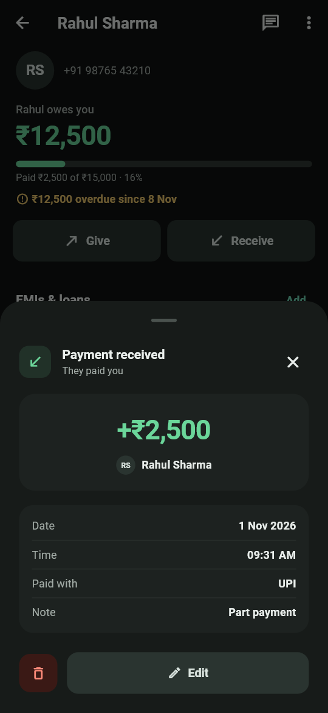
</p>

One ledger entry: amount, person, date, time, method and note, with edit and delete.

### Add person

<p>
  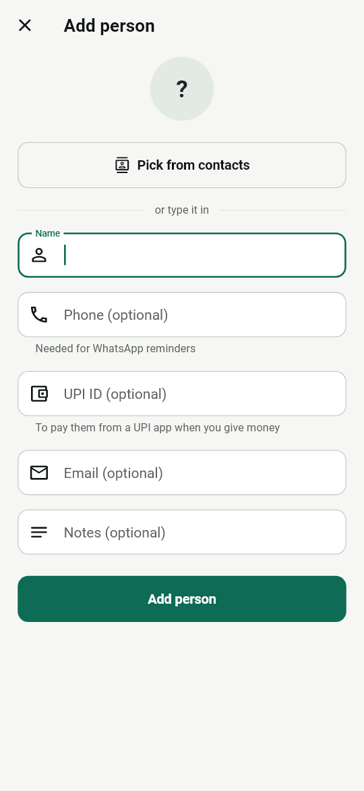
  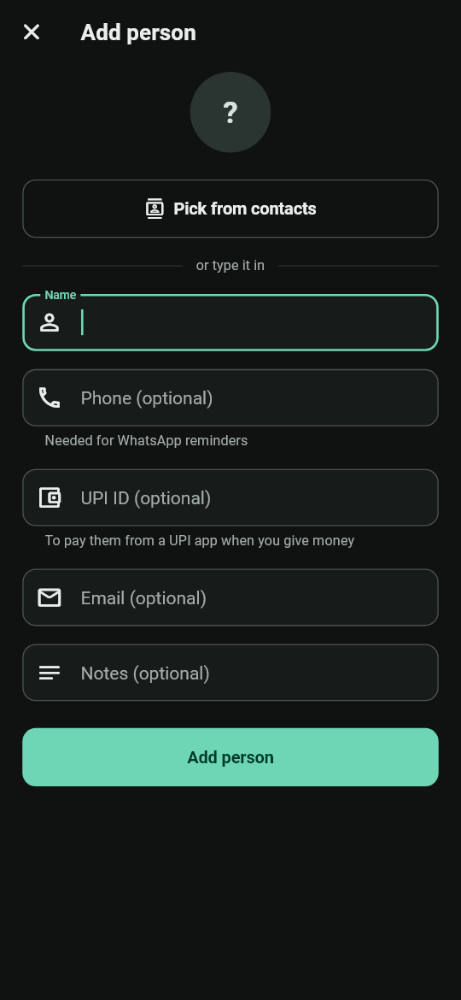
</p>

Pick from contacts or type a name; phone (needed for WhatsApp reminders), UPI ID (to pay them from
a UPI app), email and notes are optional. Adding someone who's already in the ledger offers to open their ledger instead.
